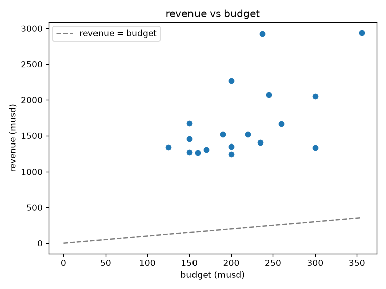
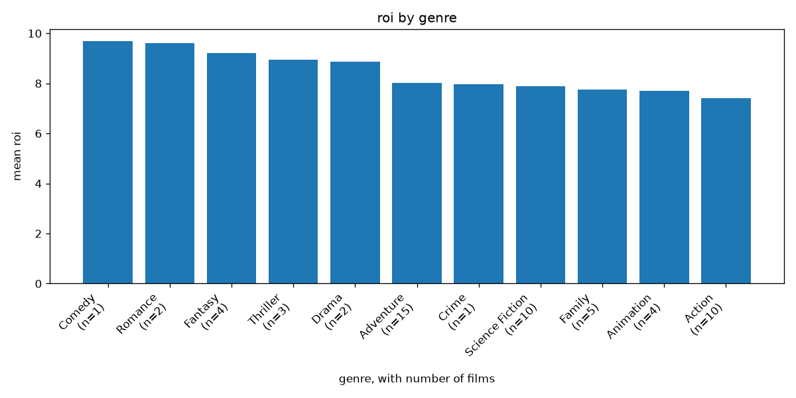
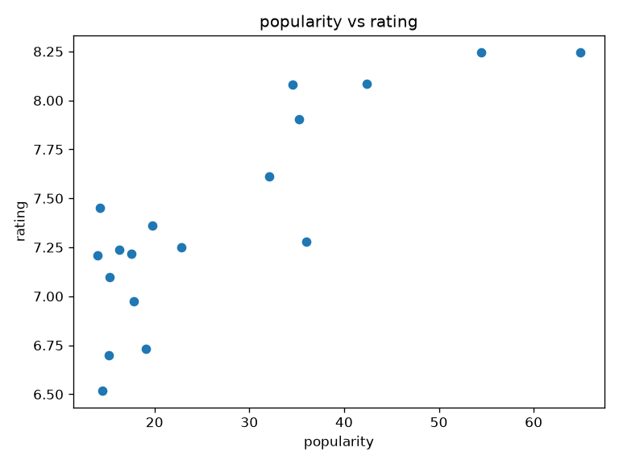
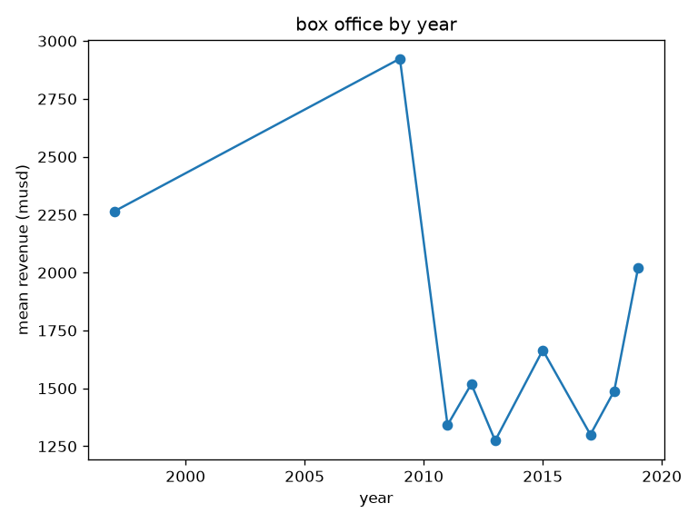
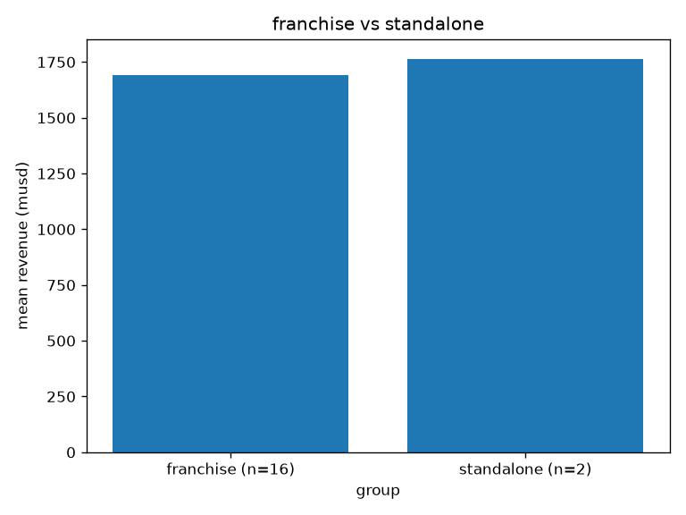
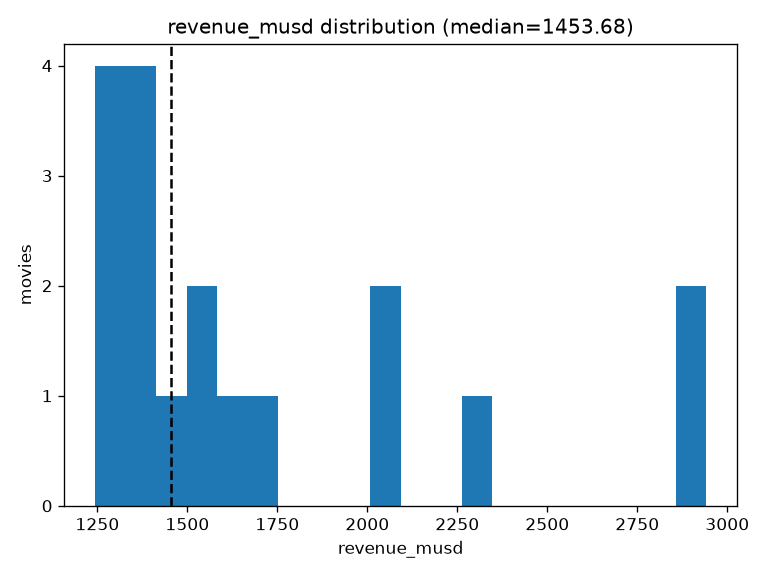
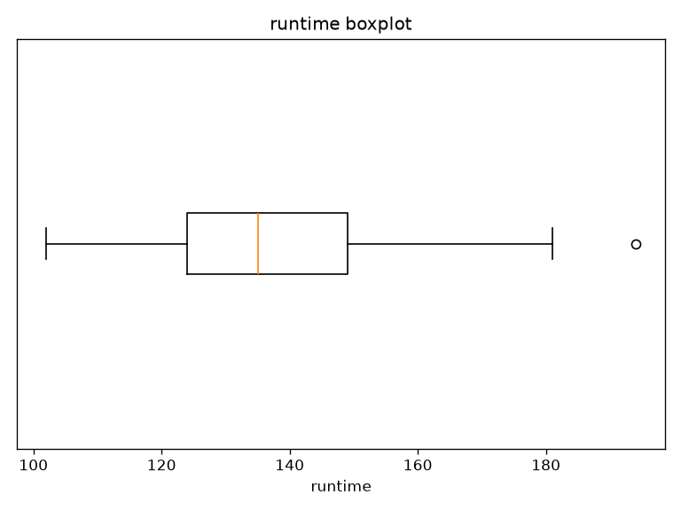
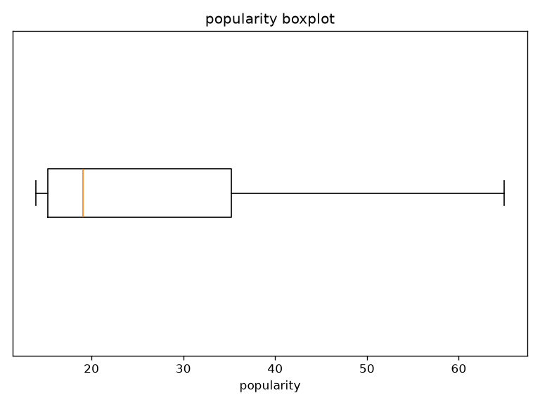

# results

made by `python -m src.main`. money columns are in million usd.

## data

raw: 18 movies (0 unreadable lines). after cleaning: 18 movies, 25 columns. data checks passed.

### cleaned movies

| idx | id | title | release_date | budget_musd | revenue_musd | vote_count | vote_average | popularity | runtime | director |
|---|---|---|---|---|---|---|---|---|---|---|
| 0 | 597 | Titanic | 1997-12-18 | 200.00 | 2,264.16 | 28009 | 7.90 | 35.22 | 194.00 | James Cameron |
| 1 | 12445 | Harry Potter and the Deathly Hallows: Part 2 | 2011-07-12 | 125.00 | 1,341.51 | 22688 | 8.08 | 34.53 | 130.00 | David Yates |
| 2 | 19995 | Avatar | 2009-12-16 | 237.00 | 2,923.71 | 34959 | 7.61 | 32.07 | 162.00 | James Cameron |
| 3 | 24428 | The Avengers | 2012-04-25 | 220.00 | 1,518.82 | 40259 | 8.08 | 42.38 | 143.00 | Joss Whedon |
| 4 | 99861 | Avengers: Age of Ultron | 2015-04-22 | 235.00 | 1,405.40 | 25285 | 7.28 | 35.97 | 141.00 | Joss Whedon |
| 5 | 109445 | Frozen | 2013-11-20 | 150.00 | 1,274.22 | 18047 | 7.25 | 22.80 | 102.00 | Jennifer Lee\|Chris Buck |
| 6 | 135397 | Jurassic World | 2015-06-06 | 150.00 | 1,671.54 | 22082 | 6.70 | 15.20 | 124.00 | Colin Trevorrow |
| 7 | 140607 | Star Wars: The Force Awakens | 2015-12-15 | 245.00 | 2,068.22 | 21092 | 7.24 | 16.32 | 136.00 | J.J. Abrams |
| 8 | 168259 | Furious 7 | 2015-04-01 | 190.00 | 1,515.40 | 11616 | 7.21 | 13.96 | 138.00 | James Wan |
| 9 | 181808 | Star Wars: The Last Jedi | 2017-12-13 | 300.00 | 1,334.41 | 16840 | 6.73 | 19.07 | 152.00 | Rian Johnson |
| 10 | 260513 | Incredibles 2 | 2018-06-14 | 200.00 | 1,243.23 | 14063 | 7.45 | 14.23 | 118.00 | Brad Bird |
| 11 | 284054 | Black Panther | 2018-02-13 | 200.00 | 1,349.93 | 24186 | 7.36 | 19.79 | 135.00 | Ryan Coogler |
| 12 | 299534 | Avengers: Endgame | 2019-04-24 | 356.00 | 2,942.19 | 29209 | 8.25 | 64.93 | 181.00 | Joe Russo\|Anthony Russo |
| 13 | 299536 | Avengers: Infinity War | 2018-04-25 | 300.00 | 2,052.42 | 33324 | 8.25 | 54.46 | 149.00 | Anthony Russo\|Joe Russo |
| 14 | 321612 | Beauty and the Beast | 2017-03-16 | 160.00 | 1,266.12 | 16279 | 6.97 | 17.84 | 129.00 | Bill Condon |
| 15 | 330457 | Frozen II | 2019-11-20 | 150.00 | 1,453.68 | 10557 | 7.22 | 17.53 | 103.00 | Jennifer Lee\|Chris Buck |
| 16 | 351286 | Jurassic World: Fallen Kingdom | 2018-06-06 | 170.00 | 1,310.47 | 13138 | 6.52 | 14.46 | 129.00 | J. A. Bayona |
| 17 | 420818 | The Lion King | 2019-07-12 | 260.00 | 1,662.02 | 10999 | 7.10 | 15.28 | 118.00 | Jon Favreau |

## value counts (step 2.4)

### genres

| genres | count |
|---|---|
| Adventure | 15 |
| Action | 10 |
| Science Fiction | 10 |
| Family | 5 |
| Animation | 4 |
| Fantasy | 4 |
| Thriller | 3 |
| Drama | 2 |
| Romance | 2 |
| Comedy | 1 |
| Crime | 1 |

### original_language

| original_language | count |
|---|---|
| en | 18 |

### production_countries

| production_countries | count |
|---|---|
| United States of America | 18 |
| United Kingdom | 2 |

### spoken_languages

| spoken_languages | count |
|---|---|
| English | 18 |
| Russian | 3 |
| Xhosa | 3 |
| French | 2 |
| Spanish | 2 |
| Arabic | 1 |
| German | 1 |
| Hindi | 1 |
| Italian | 1 |
| Japanese | 1 |
| Korean | 1 |
| Swahili | 1 |
| Swedish | 1 |
| Thai | 1 |

### belongs_to_collection

| belongs_to_collection | count |
|---|---|
| The Avengers Collection | 4 |
| Frozen Collection | 2 |
| Jurassic Park Collection | 2 |
| Star Wars Collection | 2 |
| Avatar Collection | 1 |
| Black Panther Collection | 1 |
| Harry Potter Collection | 1 |
| The Fast and the Furious Collection | 1 |
| The Incredibles Collection | 1 |
| The Lion King (Reboot) Collection | 1 |

### nulls per column after cleaning

| idx | id | title | tagline | release_date | genres | belongs_to_collection | original_language | budget_musd | revenue_musd | production_companies | production_countries | vote_count | vote_average | popularity | runtime | overview | spoken_languages | poster_path | cast | cast_size | director | crew_size | profit_musd | roi |
|---|---|---|---|---|---|---|---|---|---|---|---|---|---|---|---|---|---|---|---|---|---|---|---|---|
| 0 | 0 | 0 | 0 | 0 | 0 | 2 | 0 | 0 | 0 | 0 | 0 | 0 | 0 | 0 | 0 | 0 | 0 | 0 | 0 | 0 | 0 | 0 | 0 | 0 |

## best and worst movies (step 3.1)

### top revenue

| title | revenue_musd |
|---|---|
| Avengers: Endgame | 2,942.19 |
| Avatar | 2,923.71 |
| Titanic | 2,264.16 |
| Star Wars: The Force Awakens | 2,068.22 |
| Avengers: Infinity War | 2,052.42 |

### top budget

| title | budget_musd |
|---|---|
| Avengers: Endgame | 356.00 |
| Avengers: Infinity War | 300.00 |
| Star Wars: The Last Jedi | 300.00 |
| The Lion King | 260.00 |
| Star Wars: The Force Awakens | 245.00 |

### top profit

| title | profit_musd |
|---|---|
| Avatar | 2,686.71 |
| Avengers: Endgame | 2,586.19 |
| Titanic | 2,064.16 |
| Star Wars: The Force Awakens | 1,823.22 |
| Avengers: Infinity War | 1,752.42 |

### low profit

| title | profit_musd |
|---|---|
| Star Wars: The Last Jedi | 1,034.41 |
| Incredibles 2 | 1,043.23 |
| Beauty and the Beast | 1,106.12 |
| Frozen | 1,124.22 |
| Jurassic World: Fallen Kingdom | 1,140.47 |

### top roi (budget >= 10M)

| title | roi |
|---|---|
| Avatar | 12.34 |
| Titanic | 11.32 |
| Jurassic World | 11.14 |
| Harry Potter and the Deathly Hallows: Part 2 | 10.73 |
| Frozen II | 9.69 |

### low roi (budget >= 10M)

| title | roi |
|---|---|
| Star Wars: The Last Jedi | 4.45 |
| Avengers: Age of Ultron | 5.98 |
| Incredibles 2 | 6.22 |
| The Lion King | 6.39 |
| Black Panther | 6.75 |

### most voted

| title | vote_count |
|---|---|
| The Avengers | 40259 |
| Avatar | 34959 |
| Avengers: Infinity War | 33324 |
| Avengers: Endgame | 29209 |
| Titanic | 28009 |

### top rated (>= 10 votes)

| title | vote_average |
|---|---|
| Avengers: Endgame | 8.25 |
| Avengers: Infinity War | 8.25 |
| The Avengers | 8.08 |
| Harry Potter and the Deathly Hallows: Part 2 | 8.08 |
| Titanic | 7.90 |

### low rated (>= 10 votes)

| title | vote_average |
|---|---|
| Jurassic World: Fallen Kingdom | 6.52 |
| Jurassic World | 6.70 |
| Star Wars: The Last Jedi | 6.73 |
| Beauty and the Beast | 6.97 |
| The Lion King | 7.10 |

### most popular

| title | popularity |
|---|---|
| Avengers: Endgame | 64.93 |
| Avengers: Infinity War | 54.46 |
| The Avengers | 42.38 |
| Avengers: Age of Ultron | 35.97 |
| Titanic | 35.22 |

## searches (step 3.2)

### search 1: sci-fi action with bruce willis

0 matches.

_no rows_

### search 2: uma thurman, directed by quentin tarantino

0 matches.

_no rows_

## franchise vs standalone (step 3.3)

| group | movies | mean_revenue | median_roi | mean_budget | mean_popularity | mean_rating |
|---|---|---|---|---|---|---|
| franchise | 16 | 1,691.70 | 7.71 | 218.00 | 27.06 | 7.40 |
| standalone | 2 | 1,765.10 | 7.91 | 180.00 | 26.53 | 7.44 |

## most successful franchises (step 3.4)

| franchise | movies | total_revenue | mean_revenue | total_budget | mean_budget | mean_rating |
|---|---|---|---|---|---|---|
| The Avengers Collection | 4 | 7,918.80 | 1,979.70 | 1,111.00 | 277.80 | 7.96 |
| Star Wars Collection | 2 | 3,402.60 | 1,701.30 | 545.00 | 272.50 | 6.98 |
| Jurassic Park Collection | 2 | 2,982.00 | 1,491.00 | 320.00 | 160.00 | 6.61 |
| Avatar Collection | 1 | 2,923.70 | 2,923.70 | 237.00 | 237.00 | 7.61 |
| Frozen Collection | 2 | 2,727.90 | 1,364.00 | 300.00 | 150.00 | 7.23 |
| The Lion King (Reboot) Collection | 1 | 1,662.00 | 1,662.00 | 260.00 | 260.00 | 7.10 |
| The Fast and the Furious Collection | 1 | 1,515.40 | 1,515.40 | 190.00 | 190.00 | 7.21 |
| Black Panther Collection | 1 | 1,349.90 | 1,349.90 | 200.00 | 200.00 | 7.36 |
| Harry Potter Collection | 1 | 1,341.50 | 1,341.50 | 125.00 | 125.00 | 8.08 |
| The Incredibles Collection | 1 | 1,243.20 | 1,243.20 | 200.00 | 200.00 | 7.45 |

## most successful directors (step 3.5)

| director | movies | total_revenue | mean_rating |
|---|---|---|---|
| James Cameron | 2 | 5,187.90 | 7.76 |
| Anthony Russo | 2 | 4,994.60 | 8.25 |
| Joe Russo | 2 | 4,994.60 | 8.25 |
| Joss Whedon | 2 | 2,924.20 | 7.68 |
| Chris Buck | 2 | 2,727.90 | 7.23 |
| Jennifer Lee | 2 | 2,727.90 | 7.23 |
| J.J. Abrams | 1 | 2,068.20 | 7.24 |
| Colin Trevorrow | 1 | 1,671.50 | 6.70 |
| Jon Favreau | 1 | 1,662.00 | 7.10 |
| James Wan | 1 | 1,515.40 | 7.21 |

## charts (step 4)

